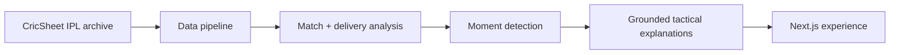

# WhyThisMoment

<p align="center">
  <strong>Cricket, with the moment explained.</strong>
  <br />
  An AI-assisted cricket explainer that reveals why tactical turning points matter.
</p>

<p align="center">
  
  
  
  
</p>

> The moment is obvious. The reason isn’t.

WhyThisMoment is an AI-assisted cricket explainer for fans who want to understand tactical turning points without getting lost in noise, speculation, or outdated post-match hot takes. It transforms match data into clear context around the key swing points in a game: the bowling change, the wicket burst, the partnership break, the phase shift, and the tactical decision that shaped the result.

This project mixes structured cricket data, tactical analysis, and optional AI-generated explanation to answer one simple question:

**“Why did this moment matter?”**

---

## Why this project exists

In cricket, a key over often feels self-explanatory until you ask the real question:

- Why was that bowling change necessary?
- Why did the run rate suddenly spike?
- Was the wicket the trigger, or the consequence?
- What changed in match pressure at that point?

WhyThisMoment answers those questions with a more grounded lens:

- Performance pressure by phase
- Score progression and run-rate context
- Wicket and partnership influence
- Over-by-over tactical story
- AI support to make the answer readable and understandable

---

## ✨ What makes it special

- AI-assisted tactical explanations for cricket moments
- Grounded analysis based on match state and match history
- Focus on match pressure, phases, and tactical shifts
- Clear fact-vs-interpretation framing
- Built for fans who want clarity without fake certainty
- Designed around the “moment” rather than generic score summaries

---

## 🧠 How it works



The app does four main things:

1. Loads curated IPL archive fixtures.
2. Computes tactical and score-state metrics from deliveries.
3. Identifies high-impact moments such as turning overs or wicket clusters.
4. Produces an understandable narrative about why the moment mattered.

The system is designed to explain the “why” behind a turning point without pretending to know unrecorded intent.

---

## 📊 Project snapshot

<p align="center">
  
  
  
</p>

---

## 🏗️ Tech stack

- Next.js
- React
- TypeScript
- Framer Motion
- D3
- Zod
- Google Gemini API
- CricSheet-based dataset
- Vitest + TypeScript checks

This keeps the product fast, modular, and open to richer match analysis over time.

---

## 🔍 Core principle

WhyThisMoment does not pretend to know what the captain was thinking in the huddle.

Instead, it explains what can be known from the match itself:

- Scoring phase
- Wicket pressure
- Overs remaining
- Partnership context
- Run-rate changes
- Tactical shifts in momentum

Where the data is incomplete, the app stays explicit about uncertainty.

---

## 🚀 Getting started

Use Node.js 20.9 or newer.

```bash
npm install
npm run data
npm run generate
npm run dev
```

For production:

```bash
npm run build
npm start
```

Then copy `.env.example` to `.env.local` and add your `GEMINI_API_KEY` for generated prebuild explanations and live follow-ups.

---

## 📦 Available scripts

| Command | Purpose |
|---|---|
| `npm run dev` | Start the app locally |
| `npm run build` | Build the production app |
| `npm start` | Run the built app |
| `npm run data` | Fetch and prepare match data |
| `npm run generate` | Generate match explanations |
| `npm run typecheck` | TypeScript validation |
| `npm test` | Run the test suite |
| `npm run lint` | Run ESLint checks |

---

## 🧪 Quality and guardrails

The project is intentionally built around uncertainty-aware analysis:

- It prioritizes evidence over invented context.
- It avoids hidden-intent claims.
- It separates observed facts from interpretation.
- It explicitly warns when data cannot fully explain a decision.

This makes the output more trustworthy for fans who want clarity without overclaiming.

---

## 🧭 Project structure

```text
WhyThisMoment/
├── app/
├── components/
├── data/
├── lib/
├── scripts/
├── tests/
├── .env.example
├── DEPLOY.md
├── eslint.config.mjs
├── next-env.d.ts
├── package.json
├── tsconfig.json
├── README.md
└── package-lock.json
```

---

## ⚠️ Limits and uncertainty

This project explains tactical moments using data, not hidden intent.

It cannot fully know:

- A captain’s private strategic intent
- Exact field placements not captured in the record
- Unrecorded conversations in the huddle
- Every nuance of player psychology

The result is an evidence-based explanation layer, not a claim of certainty.

---

## 🌍 Why it matters

Cricket is often described in broad strokes:

- That over changed the game.
- The bowling change broke the partnership.
- The wicket was the defining moment.

But the real story usually lives in the details:

- Pressure curves
- Wicket clusters
- Phase changes
- Scoring rhythm
- Tactical adjustments

WhyThisMoment was built to make those details readable and useful.

---

## 🙌 Acknowledgements

- [CricSheet](https://cricsheet.org/) for match data
- [Google Gemini](https://ai.google.dev/) for optional natural-language explanation support
- The broader cricket analytics and storytelling community

---

<p align="center">
  <em>Built for fans who want explanations, not just opinions.</em>
</p>
